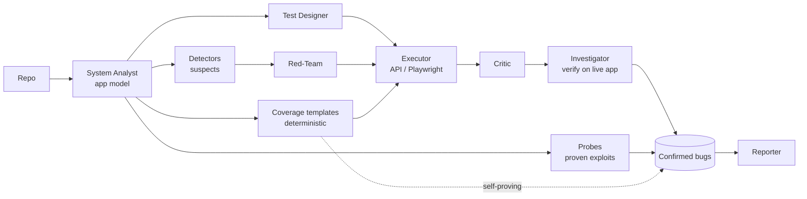
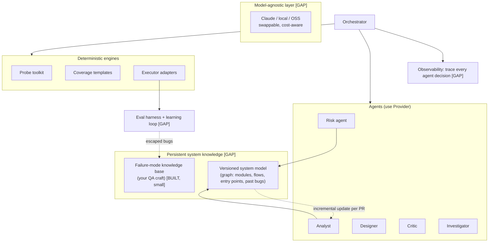

# QAX — Target Architecture (anchored to what exists)

> This is an *evolution* of the code built this session, not a greenfield design.
> **[BUILT]** = exists today. **[GAP]** = needs building. **[CHANGE]** = refactor of
> something real.

## 1. Agents vs deterministic steps — the honest split

The single biggest design mistake in "agentic" products is making everything an LLM
agent. QAX's own evidence says otherwise: the **deterministic** parts (probes, coverage
templates) caught real bugs with **zero model calls**, while the **LLM** parts (Critic,
Investigator) had false positives. Rule: **LLM only where judgement/creativity is
irreducible; deterministic everywhere else.**

| Component | Agent or deterministic? | Why |
|---|---|---|
| System Analyst (model the repo) | **LLM** [BUILT: `appmodel_service`] | understanding is judgement |
| Risk ranker | **Hybrid** [GAP] | signals are deterministic (churn, complexity); weighting is judgement |
| Detectors (failure patterns) | **Deterministic + 1 LLM pass** [BUILT: `detector_service`] | structure is rules; semantics is one call |
| Test Designer (functional) | **LLM** [BUILT: `generation_service`] | creative |
| Red-Team (abuse cases) | **LLM** [BUILT: `redteam_service`] | creative/adversarial |
| Coverage templates (auth/IDOR/validation/pagination) | **Deterministic** [BUILT: `coverage_goals`] | guaranteed, free, no luck |
| Probes (JWT forge, fuzz, crash) | **Deterministic** [BUILT: `execution/probes`] | exploitation is code, not prose |
| Critic (classify failure) | **LLM** [BUILT: `critic_service`] | judgement |
| Investigator (verify on live app) | **LLM + deterministic reproduction** [BUILT] | reproduce = code; verdict = judgement |
| Reporter (root-cause families) | **LLM** [BUILT: `reporter_service`] | synthesis |
| Orchestrator | **Deterministic controller** [BUILT: `orchestrator_service`] | planning/routing is state machine, not an agent |

**Verdict:** ~half of QAX is already correctly deterministic. Resist the urge to
"agentify" the Orchestrator — a planner that's a state machine is debuggable; an LLM
planner is not.

## 2. Pipeline today (BUILT)

## 3. Target architecture (what to add) — the moat parts

### The four GAP pieces that actually create a moat
1. **[GAP] Persistent, versioned, *incrementally-updated* system model.** Today it's a
   cached one-shot. A real knowledge graph updated per-commit = cheaper runs + memory of
   where bugs live. This is the hardest and most defensible piece.
2. **[GAP] Eval harness + benchmark.** Open-source repos + seeded bugs; measure
   bug-detection rate, false-positive rate, cost/run. **No change ships without moving a
   number.** Without this you are flying blind and cannot prove value to a buyer.
3. **[GAP] Model-agnostic provider layer.** Swap Claude/local/OSS; route cheap models to
   cheap steps. Removes vendor lock-in and halves cost. Low effort, high leverage.
4. **[GAP] Executor as adapters, incl. third-party agentic runners.** Don't own the
   browser. QAX decides WHAT/WHERE; let Playwright **or TesterArmy via CLI** execute. This
   is the "intelligence layer" shape from VERDICT §5(B).

### Lower-priority GAPs (real but not moat)
- Observability traces (needed for debugging + trust, not differentiation).
- Concurrency/race probe (closes planted bug #3), frontend E2E (closes #4).
- Security: customer-code handling, on-prem/self-host, data retention — required to SELL
  to the security buyer, so treat as table-stakes, not optional.

## 4. Why this survives model changes
- The **value lives in the deterministic engines + knowledge graph + evals**, which don't
  rot when the model improves — they get *better* with a better model plugged in.
- The LLM is a swappable component behind the provider layer, not the product.
- Caching/replay (BUILT for the app model; extend to all steps) makes repeat runs
  near-zero cost until the system changes — the economics a SaaS needs.
